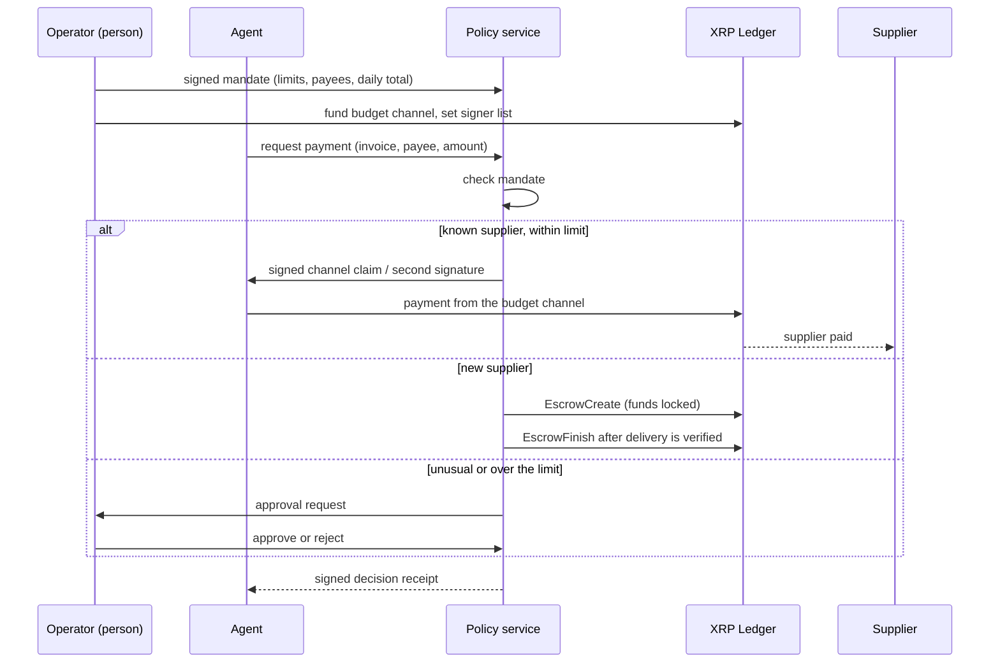

# Kitro

**A treasury agent for businesses on the XRP Ledger, with limits the agent can't change.**

An AI agent pays a company's bills. A person sets the rules. The XRP Ledger and an independent policy service enforce them, so the agent can ask for a payment but can never approve its own. No custom smart contract is deployed: native XRPL features hold the money and check the signatures.

> **Status: design draft.** Testnet only, not audited. Nothing in this repository is described as working unless its status says so. Interfaces will change. Replace every `[bracketed]` item before publishing.

## Contents

- [Why](#why)
- [How it works](#how-it-works)
- [What this repository provides](#what-this-repository-provides)
- [The mandate](#the-mandate)
- [Installation](#installation)
- [Usage](#usage)
- [HTTP interfaces](#http-interfaces)
- [Security model](#security-model)
- [Scope and limitations](#scope-and-limitations)
- [Repository layout](#repository-layout)
- [Development](#development)
- [Contributing](#contributing)
- [License and acknowledgments](#license-and-acknowledgments)

## Why

Finance teams want agents to pay suppliers, but giving an agent a wallet gives it the whole balance. One bug, one prompt injection or one bad invoice and the money is gone. So people approve every payment by hand, and the agent saves no time.

Kitro moves the limits **out of the agent's reach**. The agent holds one signing key, and every payment also needs a signature from something it doesn't control. Three controls work together:

1. **A funded budget** that the agent can't overdraw (an XRPL Payment Channel).
2. **A policy co-signer** that signs only what fits the operator's mandate (XRPL multisig).
3. **Verified escrow** for suppliers the business hasn't paid before.

Our first customer is [named customer], who pays [number] suppliers every [week/month]. [One sentence on their pain.]

## How it works



| Case | XRPL mechanism | Who enforces it |
| --- | --- | --- |
| Routine supplier | `PaymentChannelCreate`, then `PaymentChannelClaim` | The ledger: the channel holds a fixed amount for one fixed payee |
| Any treasury transaction | Account with a signer list (`SignerListSet`), quorum 2 | The ledger: a transaction without the policy service's signature is invalid |
| New supplier | `EscrowCreate` with a condition and `CancelAfter`, then `EscrowFinish` or `EscrowCancel` | The ledger: funds release only with the fulfillment, or return after the deadline |
| Unusual or over-limit payment | Held in the policy service's queue | A person: nothing is signed until they approve |
| Change the rules | Signed mandate update, `PaymentChannelFund`, `SignerListSet` | The operator, outside the agent |

## What this repository provides

| Component | Description | Location | Status |
| --- | --- | --- | --- |
| Mandate format | A signed list of limits: per-payment cap, daily total, allowed payees, escrow rules. | [`specs/mandate.md`](./specs/mandate.md) | Planned |
| Policy service | An independent service that checks each request against the mandate and co-signs or refuses. | [`apps/policy-service`](./apps/policy-service) | Planned |
| Budget channels | Helpers to create, fund and close one Payment Channel per routine supplier, and to sign claims. | [`packages/kitro/src/channels`](./packages/kitro/src/channels) | Planned |
| Escrow for new suppliers | Create, finish and cancel conditional escrows, with a pluggable delivery verifier. | [`packages/kitro/src/escrow`](./packages/kitro/src/escrow) | Planned |
| Operator dashboard | A page where a person sets, changes and pauses limits and approves unusual payments. | [`apps/dashboard`](./apps/dashboard) | Planned |
| Audit trail | A signed receipt for every decision, with its hash in a transaction memo when a transaction is sent. | [`packages/kitro/src/audit`](./packages/kitro/src/audit) | Planned |
| Example agent | An agent that reads invoices and requests payments. | [`apps/agent`](./apps/agent) | Planned |

Change each status to `In progress` or `Testnet-verified` only after you have run it on testnet.

## The mandate

The operator signs a mandate with their own key. The policy service accepts only mandates that carry a valid signature and a higher version number than the last one.

```json
{
  "version": 3,
  "operator": "rOperatorAddress...",
  "network": "xrpl:1",
  "perPaymentMaxDrops": "5000000",
  "dailyMaxDrops": "20000000",
  "allowedPayees": ["rSupplierA...", "rSupplierB..."],
  "newPayeeRoute": "escrow",
  "escrowMaxLockSeconds": 86400,
  "requireApprovalAboveDrops": "10000000",
  "paused": false
}
```

The policy service checks every request against these rules:

| Check | Result if it fails |
| --- | --- |
| Mandate signature valid and not older than the stored one | Refuse everything |
| Service is not paused | Refuse |
| Payee is on the allowed list | Route to escrow, or refuse if `newPayeeRoute` is `refuse` |
| Amount is at or below the per-payment cap | Refuse |
| Amount plus today's total is at or below the daily cap | Refuse |
| Amount is at or below the approval threshold | Hold for the operator |
| Escrow lock time is within `escrowMaxLockSeconds` | Refuse |

[Add or remove checks to match what you build.]

## Installation

The packages aren't published yet. Build from source:

```bash
git clone https://github.com/heyrapto/kitro
cd kitro
npm install
npm build
```

Requirements: Node.js 22 or later, pnpm. Runtime dependency: `xrpl` [version]. [List any others.]

## Usage

[Replace the sketches below with code that runs. Keep each example short, like the examples in the x402 XRPL binding that inspired this layout.]

### Operator

```ts
// 1. Fund a budget channel for a routine supplier
// 2. Set the treasury signer list: agent key + policy service key, quorum 2
// 3. Sign and submit the mandate to the policy service
```

### Agent

```ts
// Ask the policy service to pay an invoice. The agent never submits alone.
const decision = await kitro.requestPayment({
  invoiceId: "INV-1042",
  payee: "rSupplierA...",
  amountDrops: "2500000",
});
// decision.status: "paid" | "escrowed" | "needs_approval" | "refused"
```

### Policy service

```ts
// Verify the mandate signature, run the checks, then either:
//  - sign a channel claim or the second multisig signature,
//  - create an escrow for a new supplier, or
//  - queue the request for the operator.
```

## HTTP interfaces

**Policy service** ([`apps/policy-service`](./apps/policy-service)), planned design:

| Route | Purpose | Called by |
| --- | --- | --- |
| `POST /mandate` | Submit a new signed mandate | Operator |
| `GET /mandate` | Read the active mandate | Anyone |
| `POST /requests` | Request a payment | Agent |
| `GET /requests/:id` | Status: `paid`, `escrowed`, `needs_approval`, `refused` | Agent, operator |
| `POST /requests/:id/approve` | Approve a held payment | Operator (authenticated) |
| `POST /requests/:id/reject` | Reject a held payment | Operator (authenticated) |
| `POST /pause` | Stop all co-signing immediately | Operator (authenticated) |
| `GET /decisions` | Signed decision receipts | Operator, auditors |

## Security model

- **The agent can't pay alone.** Treasury transactions need two signatures (agent and policy service). The ledger rejects anything else.
- **The agent can't overspend a channel.** A channel holds a fixed amount and a fixed payee. Claims above the funded balance are invalid.
- **The policy service can't spend money by itself either.** It holds one key of two. It can refuse or sign, but it can't send a payment without the agent's request.
- **The operator keeps the master key offline.** Only the operator can change the signer list, fund or close channels, or replace the policy service.
- **Mandates are signed.** A forged or replayed mandate (older version) is refused.
- **New suppliers are paid on delivery.** Escrow funds release only with the fulfillment, and after `CancelAfter` they can only return to the treasury.
- **Decisions are recorded.** Every approve, reject and release produces a signed receipt. Sent transactions also carry its hash in a memo.
- **Use separate accounts per network.** Don't reuse a testnet account on mainnet.

## Scope and limitations

- **XRP only at first.** RLUSD and MPT support are planned, not built.
- **One channel per routine supplier.** A channel has a single fixed payee, so a business with many suppliers opens many channels, and each holds an owner reserve.
- **Daily totals are enforced by the policy service, not the ledger.** The ledger enforces the channel cap, the payee and the signature rules. If the policy service is compromised *and* the agent key is stolen, both could sign, so run the service separately and watch its logs.
- **Rejected payments leave no transaction.** Refusals are recorded in signed receipts, not on the ledger.
- **Escrow refunds wait for the deadline.** XRPL can't cancel an escrow before `CancelAfter`.
- **Multisig costs more.** A multisigned transaction pays a higher fee than a single-signed one.
- **Reserves.** The signer list, each channel and each open escrow count toward the account's reserve.
- **Delivery verification is pluggable and basic at first.** [State what your first verifier checks, for example an invoice and purchase-order match.]
- **Testnet only.** Mainnet is untested.

## Repository layout

```
packages/kitro/        library: channels, escrow, multisig helpers, mandate, audit
apps/policy-service/   independent co-signing service
apps/dashboard/        operator page: limits, approvals, pause
apps/agent/            example agent that requests payments
specs/                 mandate format and rules
scripts/               testnet setup and end-to-end scenarios
docs/                  pitch notes
```

## Development

```bash
npm install
npm check                    # lint, typecheck, build, unit tests
```

End-to-end on testnet. The setup script should create and fund throwaway testnet wallets (operator, agent, policy service, supplier) and write their seeds to a gitignored `.env`:

```bash
npm testnet:setup
npm testnet:e2e              # routine payment, blocked overspend, new-supplier escrow, limit change
```

The end-to-end run should show four results, each a public testnet transaction (or a signed refusal): a routine payment goes through, an overspend is refused, a new supplier is paid through escrow after delivery, and the same payment clears after the operator raises the limit. [Add the real script names and transaction links once they exist.]

## Contributing

Changes land through pull requests against `main`. Record design decisions with a date, a reason and an owner in `DECISIONS.md`. Never commit wallet seeds.

## License and acknowledgments

[Apache-2.0, confirm.] See `LICENSE`.

Kitro's escrow flow follows the pattern of the x402 `auth-capture` binding for the XRP Ledger, which locks a payment in escrow and releases it only after the delivery is checked. [Say whether you reuse that package or reimplement the idea, and link it.] The project started at [event name, date]; pitch notes are in `docs/pitch.md`.