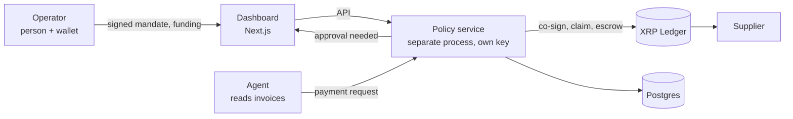

# Architecture

## Goal

Let an AI agent move money for a business while limits are enforced **somewhere the agent doesn't control**: on the ledger, by an independent service, or by a funded channel it can't overdraw. A human sets and changes those limits from outside the agent.

## Parts



| Part | Holds | Can | Can't |
| --- | --- | --- | --- |
| Operator | Master key of the treasury (offline or in a browser wallet), mandate-signing key | Change limits, fund, pause, change signers | n/a |
| Agent | One signing key (signer 1 of 2) and an API token | Request payments, sign what it asks for | Spend alone, change the mandate, approve |
| Policy service | One signing key (signer 2 of 2), the channel claim key, DB | Refuse, co-sign, sign channel claims, queue | Send a payment without the agent's signature (multisig route) |
| XRPL | The money | Reject any transaction without enough valid signatures, or over a channel's funded amount | n/a |
| Dashboard | Nothing secret | Show state, ask the operator to sign | Move money itself |

## The three payment routes

1. **Budget channel.** For routine suppliers who agree to redeem claims. The operator funds one channel per supplier. The channel holds a fixed amount for a fixed payee. The policy service signs a claim; the supplier redeems it.
2. **Multisig payment.** For known payees who are not set up for channels. The treasury account needs agent plus policy service signatures (quorum 2).
3. **Escrow.** For a payee not seen before. Funds lock in a conditional escrow. They release only when delivery is verified. After the deadline they can only return to the treasury.

Anything unusual (above the approval threshold, address change, duplicate invoice) waits in the **approval queue** until the operator says yes.

## Request flow

```mermaid
sequenceDiagram
  participant A as Agent
  participant P as Policy service
  participant L as XRPL
  participant O as Operator
  A->>P: POST /requests (invoiceId, payee, amount)
  P->>P: verify mandate signature, run rules, reserve daily spend
  alt refused
    P-->>A: refused + reasons (signed receipt)
  else needs approval
    P->>O: queue item
    O->>P: approve / reject
  end
  alt known payee, channel exists
    P->>P: sign channel claim (cumulative)
    P-->>A: claim delivered to supplier
  else known payee, no channel
    A->>P: agent-signed Payment blob
    P->>P: rebuild tx from approved request, compare, co-sign
    P->>L: submit multisigned Payment
  else new payee
    A->>P: agent-signed EscrowCreate blob
    P->>L: submit; keep fulfillment
    P->>L: EscrowFinish when delivery verified
  end
  P->>P: signed receipt; memo hash on any sent tx
```

## Trust boundaries

1. **Agent ↔ policy service.** The agent is *untrusted input*. Its output is a proposal. The service re-derives every transaction field from the approved request and signs only if they match.
2. **Invoices ↔ agent.** Invoice text is untrusted. It can contain prompt injection. The agent extracts into a fixed schema, and the service does not read free text. (ADR-0006)
3. **Operator ↔ policy service.** Only a valid signature from the operator's key changes the mandate. Higher version number only.
4. **Policy service ↔ ledger.** Final truth is a *validated* ledger. We never mark a payment paid before validation.

## Where each limit lives

| Limit | Enforced by | Strength |
| --- | --- | --- |
| Channel cap, fixed payee | XRPL | Ledger-enforced |
| Two signatures on treasury transactions | XRPL (signer list) | Ledger-enforced |
| Escrow releases only on fulfillment or returns after deadline | XRPL | Ledger-enforced |
| Per-payment cap, daily total, allowlist, approval threshold | Policy service | Service-enforced |
| Who changes the limits | Operator signature | Cryptographic |
| Treasury float (small working balance) | Operator process | Operational |

Be honest about the split in the pitch. Daily totals are service-enforced, not ledger-enforced.

## Fail closed

If the policy service is down, nothing is paid. If the database is unreachable, nothing is paid. If the mandate signature fails, nothing is paid.
