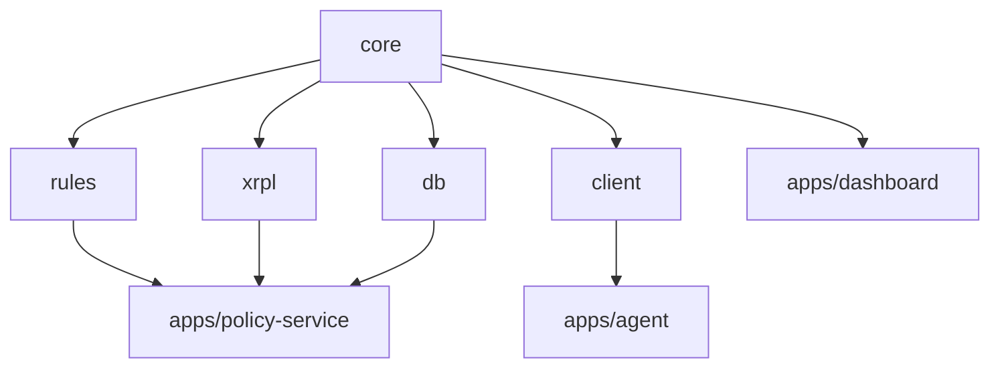

# Code structure

A pnpm + Turborepo monorepo. The folders map to the trust boundaries in ARCHITECTURE.md.

```
kitro/
├─ apps/
│  ├─ dashboard/            Next.js: operator UI (limits, approvals, pause, audit)
│  ├─ policy-service/       Hono: the independent co-signer and rule checker
│  └─ agent/                Reads invoices, requests payments (example agent)
├─ packages/
│  ├─ core/                 Shared types, zod schemas, mandate, canonical hashing
│  ├─ rules/                Pure policy engine: evaluate(mandate, request, state)
│  ├─ xrpl/                 Thin wrappers: client, channels, multisig, escrow, memos
│  ├─ client/               kitro.requestPayment() SDK the agent uses
│  └─ db/                   Drizzle schema, migrations, queries
├─ scripts/                 Testnet setup, end-to-end scenarios, seed data
├─ docs/                    These docs
├─ .env.example
├─ turbo.json
└─ pnpm-workspace.yaml
```

## Who may import whom



- `rules` imports only `core`. No network, no database, no XRPL. That keeps it testable and keeps the decision logic honest.
- `agent` may import `client` and `core` only. **It never imports `rules`, `db` or the service's key code.**
- `dashboard` never imports `xrpl` signing code with keys. It asks a browser wallet to sign.

## Module responsibilities

| Path | Owns |
| --- | --- |
| `packages/core/src/mandate.ts` | Mandate type, zod schema, `canonicalHash`, `verifyMandate` |
| `packages/core/src/request.ts` | Payment request schema, idempotency key (`invoiceId`) |
| `packages/core/src/receipt.ts` | Decision receipt type, `signReceipt`, `verifyReceipt` |
| `packages/rules/src/evaluate.ts` | The decision function and reason codes |
| `packages/rules/src/evaluate.test.ts` | Table-driven tests, one row per rule |
| `packages/xrpl/src/client.ts` | Connect, retry, `submitValidated` |
| `packages/xrpl/src/multisig.ts` | Build, sign, compare, combine, submit |
| `packages/xrpl/src/channels.ts` | Create, fund, sign cumulative claim, close |
| `packages/xrpl/src/escrow.ts` | Condition, create, finish, cancel |
| `packages/xrpl/src/memo.ts` | Hex memo helpers for audit hashes |
| `packages/db/src/schema.ts` | Tables listed in TECHNICAL_SPEC.md |
| `apps/policy-service/src/routes/*.ts` | HTTP routes |
| `apps/policy-service/src/workers/*.ts` | Escrow finisher/canceller, request expiry |
| `apps/dashboard/app/(app)/*` | Pages: overview, mandate, requests, channels, audit |
| `apps/dashboard/lib/wallet.ts` | Browser wallet adapter (sign message / sign tx) |
| `apps/agent/src/extract.ts` | Invoice to structured data (zod) |
| `apps/agent/src/run.ts` | Loop: extract, request, report |

## Conventions

- Amounts are **strings of drops** everywhere. Never floats.
- Every request has an `invoiceId` that doubles as the idempotency key.
- Reason codes are an enum (`PAYEE_NOT_ALLOWED`, `OVER_DAILY_CAP`, ...). The UI and the receipts use the same enum.
- Time is UTC. The "day" for the daily cap starts at 00:00 UTC.
- Secrets only in `.env` (gitignored). `.env.example` lists names, never values.
