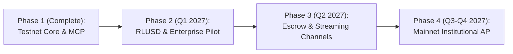

# KITRO — INVESTOR MEMORANDUM

**CONFIDENTIAL**  
**Project:** Kitro  
**Tagline:** Policy-Controlled Autonomous Treasury Infrastructure for Businesses on XRPL  
**Core Thesis:** *"Let AI handle the work. Keep control of the money."*  
**Date:** November 2026  

---

## 1. Executive Summary

Autonomous AI agents are rapidly moving from read-only workflows (summarization, research, drafting) to active operational tasks: procurement, vendor management, SaaS billing, payroll, and invoice settlement. However, enterprise adoption faces a fatal blocker: **the Autonomous Agent Financial Dilemma**.

Under traditional crypto architectures, giving an AI agent financial capabilities requires giving it a private key. Because Large Language Models (LLMs) are probabilistic and prone to hallucination, prompt injection, and logic drifting, handing an AI agent an unconstrained private key is fiduciary malpractice.

**Kitro solves this dilemma.**

Kitro is an institutional-grade, policy-controlled autonomous treasury platform engineered natively for the XRP Ledger (XRPL). Kitro introduces a strict **Separation of Powers**:
1. **AI Agent (Intelligence):** Ingests invoices, extracts structured metadata, and requests payments via standardized MCP tools or APIs.
2. **Policy Referee (Deterministic Authorization):** An independent, stateless financial referee that deterministically evaluates requests against cryptographic corporate mandates (spending caps, daily velocity limits, approved supplier allowlists, and auto-approval thresholds).
3. **XRPL Multisignature (Native Settlement):** The corporate treasury account is enforced natively on the XRP Ledger using a **2-of-2 SignerList**. Transactions require valid cryptographic signatures from *both* the AI Agent and the Policy Referee.

Even if an attacker compromises the AI agent completely, **the agent cannot move a single drop of XRP on its own.** The ledger itself rejects single-signature transactions. Conversely, the Policy Referee cannot generate transactions without the agent's intent.

---

## 2. The Problem: The Agentic Financial Dilemma

As businesses deploy autonomous agents to streamline back-office workflows, the friction in accounts payable (AP) and treasury management is glaring:
- **Human Bottleneck:** Finance teams spend hundreds of hours manually verifying routine SaaS subscriptions, cloud hosting invoices, and vendor disbursements.
- **The Catastrophic Alternative:** Existing "crypto AI agent" projects delegate raw private keys directly to agent runtimes (or custodial MPC keys managed by prompts). If the prompt is jailbroken or an invoice contains an adversarial injection attack, the treasury is drained irreversibly.
- **Regulatory & Compliance Failure:** Auditing probabilistic AI decisions is impossible without deterministic, cryptographically signed decision receipts and immutable ledger anchors.

---

## 3. Product Architecture: Separation of Powers

Kitro separates responsibilities across three logically and physically isolated planes:

```
┌─────────────────────────────────────────────────────────────┐
│                    KITRO ARCHITECTURE                       │
└─────────────────────────────────────────────────────────────┘

  [ Invoices / AP ]
          │
          ▼
┌──────────────────┐
│     AI AGENT     │  • LLM Extraction (Claude / Vercel AI SDK)
│  (Intelligence)  │  • Prepares Payment Intent
└─────────┬────────┘  • Signs as Signer #1 (Agent Key)
          │
          ▼ HTTP / MCP
┌──────────────────┐
│  POLICY REFEREE  │  • Deterministic Rule Engine (Zod / TypeScript)
│ (Authorization)  │  • Cryptographic Mandate Verification (Ed25519)
└─────────┬────────┘  • Atomic Daily Spend Reservation (PostgreSQL / Drizzle)
          │           • Rebuilds & Verifies Transaction Equality
          │           • Signs as Signer #2 (Policy Key)
          │
          ▼ 2-of-2 Multisign Combine
┌─────────────────────────────────────────────────────────────┐
│                 XRP LEDGER (Native Settlement)              │
│  • Quorum = 2 / 2 (Native SignerList)                       │
│  • Single-signature attempts fail instantly (tefBAD_QUORUM)  │
│  • Deterministic 3-5 second finality                        │
└─────────────────────────────────────────────────────────────┘
```

### Key Technical Innovations:
- **Rebuild-and-Compare Co-Signing:** The policy referee never blindly signs transaction blobs provided by the agent. It reconstructs the expected transaction fields (`Account`, `Destination`, `Amount`, `Fee`, `Sequence`) from the approved database record and asserts byte-level equivalence before co-signing.
- **Fail-Closed Spend Reservations:** Aggregate daily spending caps are updated atomically (`INSERT ... ON CONFLICT DO UPDATE`) before authorization. If a transaction fails or expires, the reservation is released.
- **Verifiable Decision Receipts:** Every evaluation produces an immutable cryptographic receipt signed with the policy referee's private key, containing the canonical hash of the corporate mandate, the evaluation timestamp, and the reason codes.
- **Native Model Context Protocol (MCP):** Provides 8 read tools and 1 write tool (`request_payment`) for Claude Desktop, Antigravity, and OpenAI agents over Local STDIO and Remote Streamable HTTP/SSE.

---

## 4. Market & Competitive Differentiation

| Capability | Generic Crypto AI Wallets | Traditional AP Automation (Tipalti, Bill.com) | **Kitro on XRPL** |
| :--- | :--- | :--- | :--- |
| **Agent Autonomy** | Full autonomy (Dangerous) | No agent autonomy | **Supervised Autonomy** |
| **Key Custody** | Agent holds full seed | Centralized fiat rail | **2-of-2 Native Multisig** |
| **Settlement Time** | 10-60 mins (L1/L2) | 2-5 business days | **3-5 seconds (XRPL)** |
| **Transaction Fees** | $0.50 - $15.00+ | 1.5% - 3.5% + wire fees | **< $0.0001 per payment** |
| **Policy Enforcement**| Soft prompt guardrails | Rigid manual approvals | **Deterministic Cryptographic Referee** |
| **AI Protocol** | Proprietary / Webhooks | Custom API | **Open MCP Standard** |

---

## 5. Strategic Roadmap



### Phase 1: Testnet Core & MCP (Current State - Hackathon Complete)
- Native 2-of-2 XRPL SignerList implementation.
- Deterministic Hono policy service with PostgreSQL persistence and atomic spend reservations.
- Autonomous agent invoice extraction with Claude / fallback heuristics.
- Apple/Bloomberg-inspired monochrome dashboard (Next.js 16 App Router).
- Model Context Protocol server (STDIO & Streamable HTTP) with 9 tools.
- Automated Testnet deployment & end-to-end multi-scenario test suites.

### Phase 2: RLUSD Stablecoin & Enterprise Pilots (Q1 2027)
- Integration with Ripple's enterprise stablecoin (RLUSD) on XRPL for USD-denominated B2B settlements.
- Multi-currency mandates (XRP, RLUSD, EUR issued currencies).
- SOC2 Type I compliance readiness and hardware security module (HSM / AWS KMS) key management for referee signers.

### Phase 3: Conditional Escrow & Payment Channels (Q2 2027)
- XRPL Crypto-Condition Escrow integration for milestone-based service contracts (agent prepares fulfilment conditions; referee validates delivery proofs).
- High-frequency micro-payment channels (`PaymentChannelCreate`, `PaymentChannelClaim`) for AI-to-AI resource metering.

### Phase 4: Mainnet Launch & ERP Integrations (Q3-Q4 2027)
- Direct connectors for NetSuite, QuickBooks, SAP, and Xero.
- Decentralized referee networks (m-of-n independent policy validators across business units).

---

## 6. Technical Risks & Mitigations

1. **Race Conditions on Daily Limits:**
   - *Risk:* Concurrent payment requests from multiple agent threads exceed daily limits.
   - *Mitigation:* Atomic SQL reservations using PostgreSQL `INSERT ... ON CONFLICT DO UPDATE` with row-level locks, validated in unit test suites.
2. **Ledger Sequence Number Drift:**
   - *Risk:* Multiple simultaneous multisig transactions collide on account sequence numbers.
   - *Mitigation:* Sequenced transaction pipeline with explicit ticket allocation (`TicketCreate`) on the XRPL treasury account.
3. **Key Compromise:**
   - *Risk:* Agent server is breached.
   - *Mitigation:* Agent key has zero authority alone (weight = 1, quorum = 2). The treasury funds cannot be accessed without the Policy Referee key, which resides in an isolated security perimeter.
4. **LLM Hallucinations:**
   - *Risk:* Agent hallucinates a destination address or inflated invoice amount.
   - *Mitigation:* The policy referee strictly enforces destination allowlists and amount ceilings. Unrecognized destinations or excessive amounts are held or refused with cryptographic receipts.

---

## 7. Current Stage & Verifiable Evidence

Kitro is fully built, tested, and verified in the active repository:
- **107 Automated Tests Passing (100% Pass Rate)** across 6 test suites (`@kitro/rules`, `@kitro/xrpl`, `@kitro/policy-service`, `@kitro/agent`, `@kitro/mcp`).
- **Live Testnet Setup Script (`scripts/setup-testnet.ts`)**: Generates and funds disposable testnet wallets, activates the treasury, configures the 2-of-2 SignerList, and verifies ledger state.
- **End-to-End Multi-Scenario Script (`scripts/e2e.ts`)**: Proves both positive settlement (Scenario 1) and negative security proofs (Scenario 2: agent-only signing rejected by ledger; Scenario 3: over-limit refusal; Scenario 4: unknown supplier refusal).
- **Production Dashboard Build**: Zero TypeScript errors, Next.js 16 Turbopack optimized, pure monochrome high-density financial UI.
- **Complete MCP Server (`@kitro/mcp`)**: Fully compliant with Anthropic/OpenAI MCP standards with 8 read tools and 1 policy-enforced write tool.

---

## 8. Investment Opportunity & Use of Funds

**Target Seed Round:** $1,500,000  
**Structure:** SAFE with Valuation Cap  

### Allocation of Capital:
- **Engineering & Cryptography (50%):** HSM signer integration, RLUSD stablecoin support, and formal verification of mandate execution rules.
- **Security & Audits (25%):** Third-party smart contract and cryptographic audits of the XRPL multisig coordinator and policy referee.
- **Enterprise Pilot Deployments (15%):** Customer engineering for early-adopter tech companies and Web3 foundations running high-volume AP on XRPL.
- **Regulatory & Legal Compliance (10%):** Corporate treasury legal frameworks and compliance certifications (SOC2, ISO 27001).

---

## Summary

Kitro transforms the XRP Ledger into the foundational settlement layer for the autonomous agent economy. By replacing blind trust in AI with native cryptographic ledger constraints and deterministic policy referees, Kitro provides the missing institutional rail that allows enterprises to confidently unleash autonomous agents into corporate finance.
