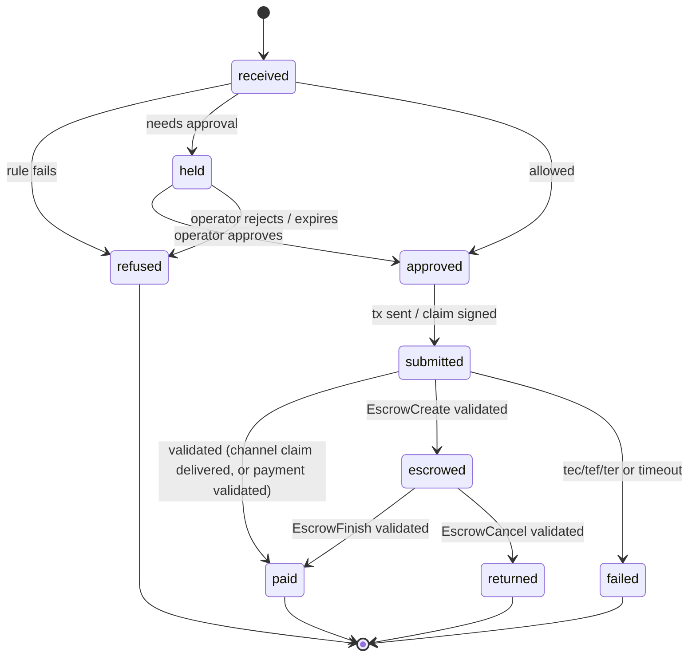

# Technical spec

## 1. Mandate

The operator's signed limits. Canonical JSON (RFC 8785), hashed with SHA-256, signed with the operator's key.

```json
{
  "version": 3,
  "operator": "rOperator...",
  "network": "xrpl:1",
  "treasury": "rTreasury...",
  "perPaymentMaxDrops": "5000000",
  "dailyMaxDrops": "20000000",
  "requireApprovalAboveDrops": "10000000",
  "payees": [
    { "address": "rSupplierA...", "name": "Supplier A", "route": "channel", "tag": 12 },
    { "address": "rSupplierB...", "name": "Supplier B", "route": "payment" }
  ],
  "newPayeeRoute": "escrow",
  "escrowMaxLockSeconds": 86400,
  "paused": false,
  "issuedAt": "2026-11-12T10:00:00Z"
}
```

Signed envelope: `{ "mandate": {...}, "publicKey": "ED...", "signature": "..." }`.

Acceptance rules for a new mandate:
1. `deriveAddress(publicKey) === mandate.operator`
2. Signature verifies over `sha256(canonical(mandate))`
3. `version` is **greater than** the stored version
4. `treasury` and `network` match the service's config

## 2. Request

```ts
{
  invoiceId: string,       // idempotency key, unique per payee
  payee: string,           // r-address
  amountDrops: string,
  destinationTag?: number,
  memo?: string,           // free text, never used for decisions
  evidence?: { poNumber?: string, deliveryRef?: string }
}
```

## 3. Decision

`evaluate(mandate, request, state) -> Decision`

```ts
type Decision =
  | { outcome: "refuse", reasons: Reason[] }
  | { outcome: "hold", reasons: Reason[] }            // needs operator approval
  | { outcome: "allow", route: "channel" | "payment" | "escrow" }
```

`state` = `{ spentTodayDrops, knownInvoiceIds, payeeFirstSeen, mandateVersionStored }`.

### Rule order (first failing rule wins unless noted)

| # | Rule | Fail result | Reason code |
| --- | --- | --- | --- |
| 1 | Mandate present and verified | refuse | `NO_MANDATE` |
| 2 | Not paused | refuse | `PAUSED` |
| 3 | `invoiceId` not seen for this payee | refuse | `DUPLICATE_INVOICE` |
| 4 | Amount is a positive integer string | refuse | `BAD_AMOUNT` |
| 5 | Amount <= `perPaymentMaxDrops` | refuse | `OVER_PER_PAYMENT_CAP` |
| 6 | spentToday + amount <= `dailyMaxDrops` | refuse | `OVER_DAILY_CAP` |
| 7 | Payee address changed vs. registry for same name | hold | `PAYEE_ADDRESS_CHANGED` |
| 8 | Amount > `requireApprovalAboveDrops` | hold | `NEEDS_APPROVAL_AMOUNT` |
| 9 | Payee in `payees` | route = that payee's `route` | - |
| 10 | Payee not in `payees` | route = `newPayeeRoute` (`escrow` or `refuse`) | `PAYEE_NOT_ALLOWED` if refuse |

All reasons are collected where it is safe (e.g. both caps), so the operator sees everything wrong at once.

## 4. Data model (Postgres)

| Table | Key columns |
| --- | --- |
| `mandates` | `version` (pk), `body` (jsonb), `signature`, `public_key`, `active` |
| `requests` | `id`, `invoice_id`, `payee`, `amount_drops`, `status`, `route`, `created_at`; unique(`payee`,`invoice_id`) |
| `decisions` | `request_id`, `outcome`, `reasons` (jsonb), `mandate_version`, `receipt` (jsonb), `receipt_hash` |
| `spend` | `day` (date), `reserved_drops`, `confirmed_drops` |
| `channels` | `channel_id`, `payee`, `amount_drops`, `claimed_total_drops`, `settle_delay`, `status` |
| `claims` | `channel_id`, `cumulative_drops`, `signature`, `request_id` |
| `escrows` | `owner_sequence`, `payee`, `amount_drops`, `condition`, `fulfillment_enc`, `cancel_after`, `status` |
| `approvals` | `request_id`, `status`, `decided_by`, `decided_at` |
| `txs` | `hash`, `request_id`, `type`, `result`, `validated`, `ledger_index` |

`fulfillment_enc` is encrypted at rest. Whoever holds the fulfillment can release the escrow to its fixed destination, so treat it like a key.

## 5. Request state machine



Daily spend is **reserved** when a request is approved and **confirmed** when validated. A failed, refused or returned request releases the reservation.

## 6. HTTP API (policy service)

Auth: agent routes use a bearer token. Operator routes require a short-lived session from the wallet challenge flow.

| Route | Auth | Purpose |
| --- | --- | --- |
| `GET /health` | none | Liveness |
| `GET /mandate` | none | Active mandate and signature |
| `POST /mandate` | operator | Submit new signed mandate |
| `POST /requests` | agent | Create request, returns decision |
| `POST /requests/:id/sign` | agent | Submit agent-signed blob for the multisig/escrow route |
| `GET /requests/:id` | agent, operator | Status and receipt |
| `GET /requests?status=held` | operator | Approval queue |
| `POST /requests/:id/approve` | operator | Approve held request |
| `POST /requests/:id/reject` | operator | Reject held request |
| `POST /pause`, `POST /resume` | operator | Emergency stop |
| `GET /decisions` | operator | Signed receipts |
| `POST /auth/challenge`, `POST /auth/verify` | none | Operator wallet sign-in |
| `POST /escrows/:id/delivered` | verifier | Mark delivery verified, finisher releases |

## 7. Receipt

```ts
{
  requestId, invoiceId, payee, amountDrops,
  outcome, reasons, route, mandateVersion,
  txHash?: string, issuedAt
}
```

Signed with the policy service key. SHA-256 of the canonical receipt is written to the `Memos` of any transaction we send:

- `MemoType` = hex("kitro/receipt")
- `MemoData` = hex(receiptHash)

Refusals have no transaction, so the signed receipt in the database is their record.

## 8. Sign-in with a wallet

1. Dashboard calls `POST /auth/challenge` with the operator address. The service returns a random nonce and an expiry (5 minutes).
2. The wallet signs the nonce string.
3. `POST /auth/verify`: the service checks the signature, that the address equals `mandate.operator`, and that the nonce is unused. It returns a session token (15 minutes).
